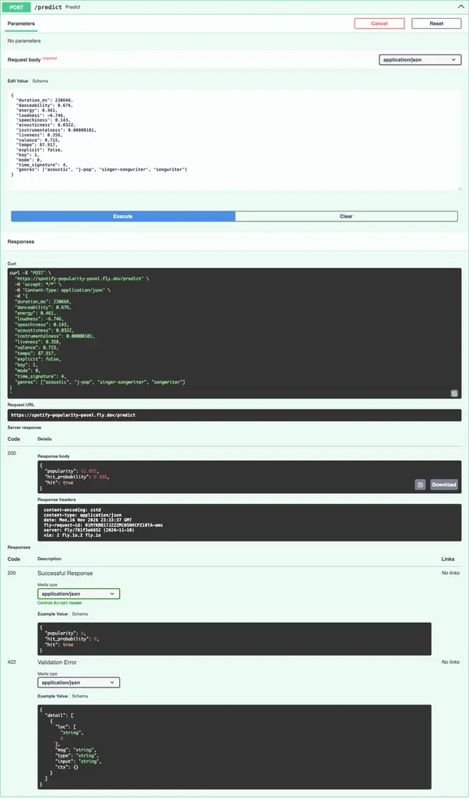
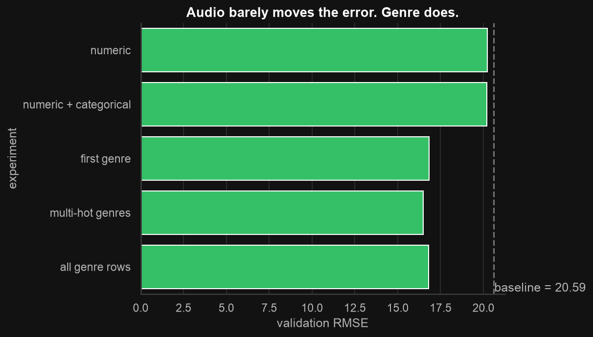
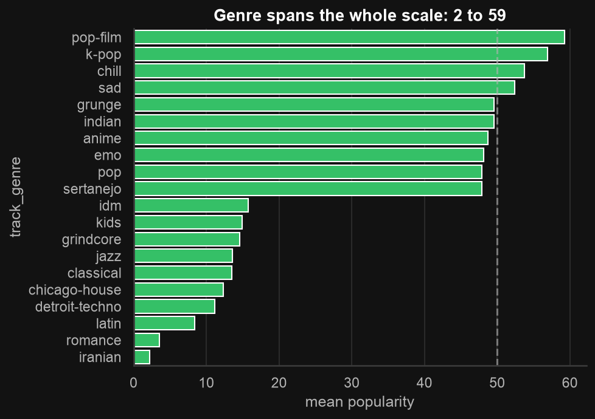
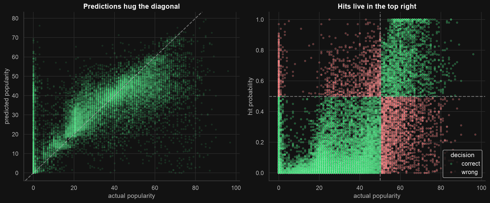
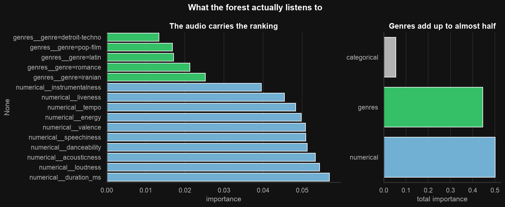
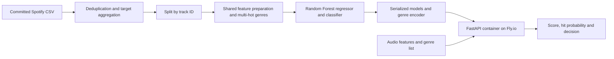

# Spotify track popularity

Can audio features and genres help predict a song's popularity? This project estimates Spotify's popularity score (0-100) and the probability that it exceeds 50. It is my midterm project for [Machine Learning Zoomcamp 2026](https://github.com/DataTalksClub/machine-learning-zoomcamp).

The notebook compares linear regression, Ridge, Random Forest and XGBoost. It also compares three representations of songs with multiple genres. The selected models are a Random Forest regressor and classifier, with every genre preserved as a multi-hot feature.

These are estimates of the score in a historical dataset, not forecasts of future streams or chart positions. Artist identity is deliberately excluded.

[](https://github.com/pavel-kalmykov/spotify-popularity/actions/workflows/ci.yml)
[](https://www.python.org/)

**Live API:** [interactive documentation](https://spotify-popularity-pavel.fly.dev/docs) | [health](https://spotify-popularity-pavel.fly.dev/health)

The public deployment is temporary and intended for peer evaluation. Local training and Docker execution remain available after it is removed.

<p align="center">
  
</p>

## Results

| Test metric | Baseline | Selected model |
| --- | ---: | ---: |
| Regression RMSE | 20.4497 | 14.2096 |
| Classification ROC AUC | 0.5000 | 0.8708 |
| Classification precision | 0.0000 | 0.6716 |
| Classification recall | 0.0000 | 0.5271 |
| Classification F1 | 0.0000 | 0.5907 |

Classification uses popularity greater than 50 as its label and a probability threshold of 0.5 for its decision. The baseline uses the training population's mean score or hit rate. The classifier's baseline predicts no hits at that threshold.

The regressor improves on the constant baseline, but substantial uncertainty remains for an individual song. The classifier identifies about half of the actual hits. Another limitation is that EDA and some preparation decisions used the full dataset before splitting; test was excluded from model fitting and tuning, but not exploratory analysis. A track-ID split also allows the same artist to occur in multiple partitions.

## The story in four charts

**Genre is the signal.** Adding the first genre label to a linear model cuts validation RMSE from 20.2 to 16.8; multi-hot encoding all of a track's genres reaches 16.5. Audio features alone barely move the error.



**Mean popularity per genre runs from 2 to 59.** The top four genres average above the hit threshold of 50; individual tracks still scatter widely within each genre.



**On the held-out test set**, the regressor hugs the diagonal (RMSE 14.21 vs a 20.45 baseline) and the classifier concentrates its hits in the top-right quadrant (ROC AUC 0.87, precision 0.67, recall 0.53). Misclassifications cluster near the threshold lines.



**What the forest listens to.** Individually the ten audio features dominate the ranking; summed by group, the 114 genre columns add up to almost as much as all of them together.



All figures come from the notebook with its Wrapped-style theme.

## Architecture



The notebook compares candidates; `train.py` reproduces the selected models without a hyperparameter search. Training, the notebook's final preparation and the API share the same feature code.

## Data and evaluation


The committed `data/spotify_tracks.csv` is the [Spotify tracks dataset](https://huggingface.co/datasets/maharshipandya/spotify-tracks-dataset) (the source card labels its license BSD). It contains 114,000 rows across 114 genres and 89,741 distinct track IDs. The stored CSV includes an index column, which the loader excludes from the features.

Exact duplicate rows are removed. Where copies of a track disagree on popularity, the maximum is used as an explicit aggregation rule, not as a verified correction. All genres are retained. Duration gets a `log1p` transform; undocumented time-signature codes are grouped as `unknown`.

The notebook splits unique track IDs into approximately 60% training, 20% validation and 20% test, then recovers their rows. Model selection uses only training and validation. Final models are trained on their combined 80% and evaluated per track on the reserved 20%. The standalone training script reproduces that final split and the fixed winning configurations without rerunning the searches.

## Run locally

You need Python 3.13 and [uv](https://docs.astral.sh/uv/). Run these commands from the repository root:

```bash
uv sync --locked --no-dev
uv run --no-dev python train.py
uv run --no-dev python predict.py
```

Training writes `models/model.joblib` and `models/metrics.json`. The artifact contains the genre encoder, both preprocessing pipelines and both forests. Generated models are excluded from git; training does not require Spotify credentials or downloading more data. Only load joblib artifacts you generated or otherwise trust.

The service listens on port 9696. In another terminal:

```bash
curl --fail http://localhost:9696/health
curl --fail http://localhost:9696/genres
curl --fail -X POST http://localhost:9696/predict \
  -H 'Content-Type: application/json' \
  --data-binary @examples/track.json
```

The example request returns:

```json
{"popularity":62.055,"hit_probability":0.888,"hit":true}
```

`POST /predict` takes the ten numerical audio features, `explicit`, `key`, `mode`, `time_signature`, and a `genres` list. `examples/track.json` is a complete request drawn from the dataset. Send raw duration in milliseconds, not its logarithm. The shared preparation applies the transforms.

The response has `popularity`, `hit_probability` and `hit`. The score and hit probability come from independently trained models, so thresholding the score is not equivalent to the classifier's decision. Invalid inputs or unknown genre labels return HTTP 422; `GET /genres` lists the accepted labels. Interactive API documentation is at `/docs`.

`MODEL_PATH` overrides the artifact path (default `models/model.joblib`), and `PORT` overrides 9696. The service fails at startup if the artifact cannot be loaded.

## Docker

Train the models first, then build and run the inference image:

```bash
uv run --no-dev python train.py
docker build -t spotify-popularity .
docker run --rm -p 9696:9696 spotify-popularity
```

Use the same curl commands above to exercise the container. The image contains the trained artifact but excludes the dataset, notebook and development dependencies. It runs as a non-root user. To choose another container port, set `PORT` and update the mapping, for example `-e PORT=8080 -p 8080:8080`.

## Notebook

The Marimo notebook contains the narrative EDA, model searches, validation results and final evaluation:

```bash
uv sync --locked
uv run marimo edit notebook.py
```

On macOS, XGBoost may require the OpenMP runtime (`brew install libomp`). XGBoost is only needed for the notebook's model comparison, not the final training script or API.

## Files

- `notebook.py` contains the experiments and their interpretation.
- `train.py` runs the final training and evaluation.
- `predict.py` starts the FastAPI service.
- `src/spotify_popularity/features.py` supplies the shared feature preparation.
- `src/spotify_popularity/model.py` defines the selected pipelines and prediction bundle.
- `src/spotify_popularity/training.py` reproduces the final models.
- `src/spotify_popularity/api.py` validates requests and serves predictions.
- `examples/track.json` supplies a complete prediction request.
- `pyproject.toml` and `uv.lock` define the runtime and notebook environments.
- `Dockerfile` packages inference.

## API tests and CI

```bash
uv sync --locked --group test
uv run --group test pytest --cov=spotify_popularity.api --cov=spotify_popularity.model --cov-branch --cov-fail-under=95
```

The tests use small, genuinely trained models and temporary artifacts. They cover request partitions and boundaries, prediction parity, the hit decision at probability 0.5, feature transformations and startup failures. They do not need the production model artifact.

GitHub Actions runs Ruff, Flake8, mypy, API tests with branch coverage, and a Docker HTTP smoke check on pushes and pull requests. It uploads test reports. A manual workflow run also trains the full models and uploads their evaluation metrics.

## Temporary deployment on Fly.io

`fly.toml` configures the service in Paris with 4 GB RAM, two shared CPUs and automatic stop/start. No machine is kept running when the app is idle. Stopped machines can still incur storage charges; automatic stopping is not the same as deleting the application.

The Docker image includes the trained model artifact. To reproduce the deployment from a fresh clone:

```bash
uv sync --locked --no-dev
uv run --no-dev python train.py
flyctl auth login
flyctl apps create spotify-popularity-pavel --org personal
flyctl deploy --remote-only --ha=false
```

Application names are globally unique. If deploying your own copy, choose another name in `fly.toml` and use it in the commands. The `apps create` command is only needed once. `--ha=false` avoids creating a spare machine. The remote model-loading process exceeded the 2 GB machine limit, so this deployment reserves 4 GB for startup headroom.

Check the deployed service with:

```bash
curl --fail https://spotify-popularity-pavel.fly.dev/health
curl --fail -X POST https://spotify-popularity-pavel.fly.dev/predict \
  -H 'Content-Type: application/json' \
  --data-binary @examples/track.json
```

The API documentation is at <https://spotify-popularity-pavel.fly.dev/docs>. The service is public and intended for this project's evaluation, not unrestricted production traffic. Its first request after an idle stop must wait for the models to load.

After evaluation, remove the temporary deployment to stop its ongoing charges:

```bash
flyctl apps destroy spotify-popularity-pavel
```

Review any remaining build resources and billing in the Fly.io dashboard as well. Deleting the application makes its public URL unavailable.
